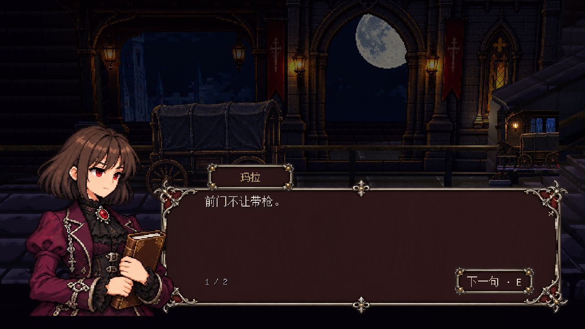
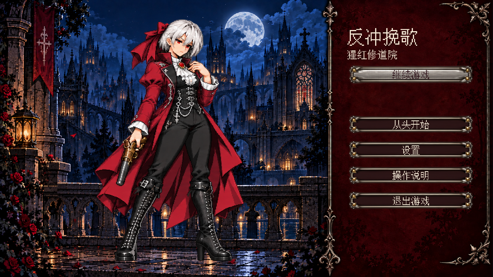
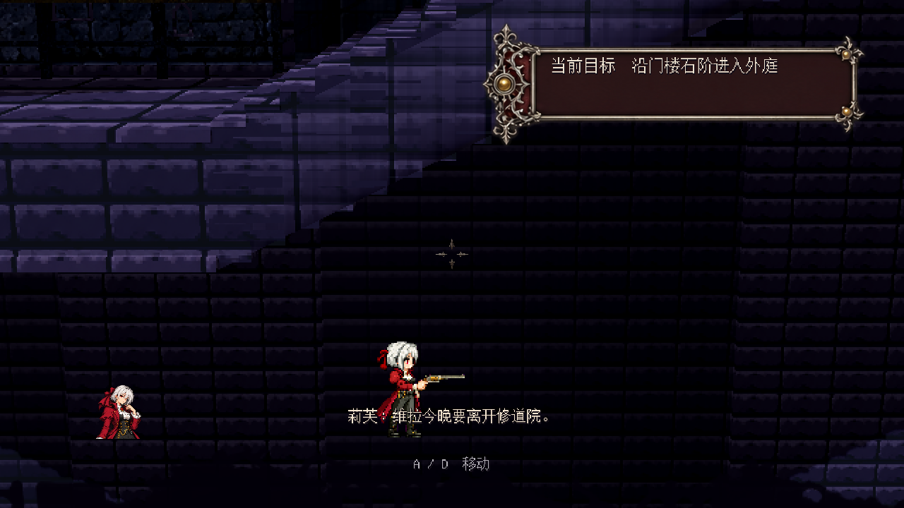

# 逐句对白、人物立绘与下落镜头

2026-09-30。本记录只覆盖本轮实际切片，不代表整章场景已与概念图完全一致。

## 已接入

- 对白按句末标点分页，保留原文、说话人和事件 ID；每页显示实际说话人的像素立绘，最后一句后才出现选择。E、空格、Enter 或点击推进；开窗键必须先释放，避免跳过第一句。
- 立绘头肩伸出文本框，身体叠在框的左缘。1280×720 下人物最长边 420、脚边 692；框从 x=330 开始，正文从 x=448 开始。采用等比缩放及原生字体，不拉伸角色；960×540 到宽屏分别检查。
- 每段对白附相关任务配图，调查和物品选择用对应道具，发车确认用货场。来源是已采用的流程图及物件图，裁区与事件映射集中在 `data/campaign/dialogue_art.json`，不靠随意新增照片填空。两次专用任务图生成因网络失败，最终复用已认可的生成图。
- 莉芙、玛拉、伊娜、鲁卡、赛琳、维拉使用六份像素肖像；白发只保留给莉芙。短棕发账房、铜发机工、深蓝编发钥匙保管者、短灰棕发卫士、黑紫长发贵族采用不同轮廓与深色哥特服装。NPC 及两名战斗角色同步修改，玩家 v5 身体和手臂未动。
- 标题五姿态重绘为严肃、闭口的神情。开始/继续为持枪待行，重新开始检查转轮，设置检查袖口机械件，说明翻书，离开回望；二级确认、设置和返回按钮也有明确映射。切换仍是单层淡出换图淡入，并非逐帧动作动画。
- 前景不再在空中保持旧高台高度，再慢慢追到落点。每帧限制实际剪影上沿，避开脚点并保留底部覆盖；横向锚点和视差不变。高速下落时镜头在脚点超过视口 86% 后同步校正，避免玩家先离开画面。
- 地图补齐货梯、维护入口的实体门锁显示。伊娜工作台扩大，并增加有独立绘制窗面的门廊和工作灯；未改变该处路线或碰撞。

## P5 参考与取舍

实际查看 [Persona 5 Royal 实机截图](https://images.nintendolife.com/screenshots/129048/large.jpg)，来源为 [Nintendo Life 游戏页](https://www.nintendolife.com/games/nintendo-switch/persona_5_royal)。参考人物伸出对话框、身体与框边重叠、正文独立留白的关系；游戏继续使用自己的像素人物、旧银与深红装饰。外部截图仅供构图研究，不进入运行资源。

## 实际截图

## 地图和场景仍需完成的部分

- 已逐项核对施工数据的 80 项几何记录与场景端点；地图显示其中 73 段可走路线。9 月 30 日增加的入院台阶、绕行桥和维护通道有实际对应构件。
- 原大图不是当前施工结果的逐像素副本：C01 现连 F06→F07，世界坐标为 (3328,0)→(4448,688)；RecoveryRoad 是 y=3840 的全宽救援底路，原示意更接近局部地下空间。这两处历史差异未在本轮悄悄拆除，需结合实际回程继续处理。
- 工坊本轮补了窗面、门廊和灯，但还未达到流程图中的完整玻璃棚与陈设密度。其他旧建筑的密度与玻璃层次仍需按同机位继续对照。

## 验证

逐句与立绘布局 55 项、GPU UI 验收 120 项通过；检查了六角色、物品选择、发车确认及 960/1280/1920/宽屏。标题姿态与二级按钮 55 项通过。敌人 104 项、NPC 交互 33 项通过，另渲染 38 个场内姿态，保留原共享尺寸与全部锚点。下落镜头和前景在 30/60/144 帧率及 GPU 检查各 13,512 项通过。上述均是自动输入/脚本渲染，不是新的一次真人完整通关。

整套回归与唯一运行包结果见下方收尾记录。原图、生成提示词和裁区分别见 `assets/ui/v2/DIALOGUE_ART_PROMPTS.json`、`data/campaign/dialogue_art.json`、`assets/characters/campaign/IDENTITY_V2.md` 与 `assets/characters/npcs/GOTHIC_V3.md`。

## 收尾验证与运行包

`tools/run_checks.ps1` 完整运行退出 0：30/60/144 物理与手感、任务/存档/对白、地图与编辑器、360°持枪、UI和前景回归均通过，日志 `artifacts/final-dialogue-regression.log`。初次运行发现旧对白测试替身仍只接受三参数，已同步第四个事件 ID 参数后重新跑完整套件；没有用跳过检查处理。

唯一输出 `builds/windows/RecoilRequiem.exe` 已覆盖，以本机 Godot 4.7.2 debug 导出模板构建。从嵌入包独立检查新立绘、NPC、地图与开发资料排除，0失败；EXE 独立启动180帧、退出0，日志无运行错误。测试使用 `--campaign-test`，不覆盖玩家正式存档。

EXE SHA-256：`5C34F290A869A263A3CE7CA7B3E296125822F610035803ACDE4C78A0F50344A8`。导出/资源/启动日志分别为 `artifacts/dialogue-export.log`、`dialogue-export-content.log`、`dialogue-export-launch.log`。源码、采用素材和本记录提交至授权的私人仓库 main；EXE 按项目既有规则只保留本地唯一文件。

### 独立名字框补充

说话人姓名移到对白左上沿的独立名牌（1280布局 x448/y352、最小200×72），沿用已有生成的 `button_normal.png` 旧银深红框，原生字体居中，正文不重复姓名。名牌与当页立绘同步，关闭及物品调查时清除。实机检查960、1280、1920与宽屏：立绘不交叠、正文留出间距、姓名留在框内。逐句测试79项和完整UI渲染验收120项通过；该补丁未修改玩法与台词，因此没有重复上一轮全游戏回归。

名字框补丁已覆盖唯一EXE，嵌入资源检查0失败，独立启动180帧退出0。当前包SHA-256：1733317786A0E77D968E64145791A3DA238D82D1707CF61AE11726F7DFFF1F3D。
