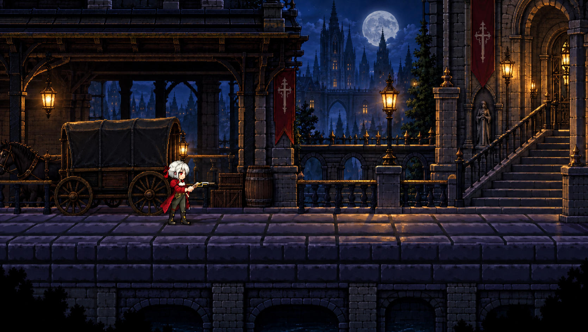
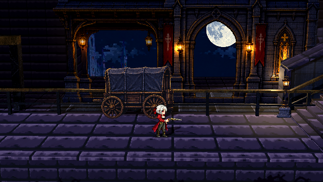
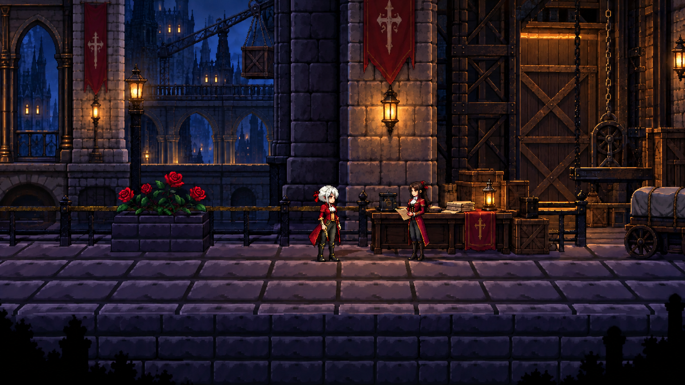
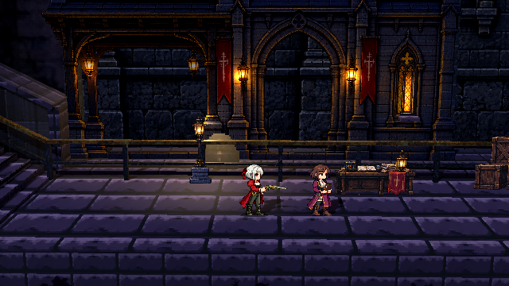
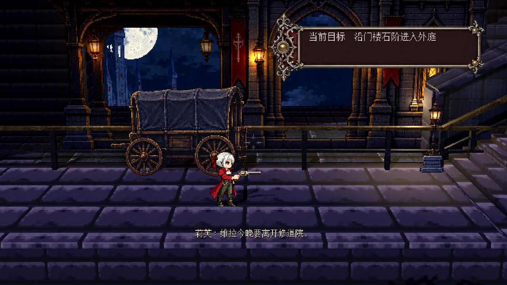
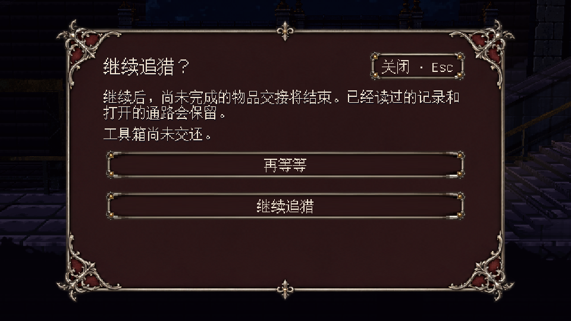

# 流程接入与画面检查

2026-09-30。用户已批准按图施工，并要求完成后同步 GitHub。主入口、原白发莉芙和三枪保持现有版本；本次修改源工程，Windows 运行文件也已重新导出。

## 已接入的流程

| 图稿节点 | 实际接入 | 检查依据 |
|---|---|---|
| 01 抵达 | 新出生点 `(1260,1120)`，车厢在身后，石阶在右侧视野内；移动完成后收起提示 | 实际入口键鼠输入检查、连续回放 |
| 02 石阶 | 独立支撑石阶，可一直按 A/D 走过；跳跃与试射提示只在附近出现 | 实际控制器零弹药步行 |
| 03 首场交锋 | 一名盾卫，上层旁路可绕过；不要求击杀才能见玛拉，警戒不会追进会面区 | 敌人数量、警戒边界与实体路线检查 |
| 04 外庭 | 玛拉会面保留短对白；账本桌、货物和纸板门廊实际接入 | 交互与对白回归、同距离渲染 |
| 05 货梯 | 维拉交谈后沿作者布置的道路连续行走，使用行走动作；货梯卡榫维修与工具归属分开 | 位移与动作检查、关闭货梯时实际走到会面处 |
| 06 合作 | 赛琳实际攻击侧面威胁，两名敌人先后警戒；她不会独自清完遭遇 | 攻击/收招动作、警戒检查 |
| 07 双路线 | 现场维修开启货梯近路；维护道经安全隔离杆开放，不要求工具或记录；选定路线持久保存 | 双路线步行、反向返回、门锁与存档 |
| 08 支线 | 工具交付与现场使用分开；记录接收者说明用途；行李改变真实掩体、踏板、射线和调查点 | 互斥事实、提前取物、两处行李实体测试 |
| 09 整备 | 独立发车面板列出已知未办事项；“再等等”先获焦点，需松开原交互键才能确认；保存失败留在原状态 | 文件写入失败注入、960/1280/1920/宽屏实机 UI |
| 10 赛琳战 | 开战前确认；非致命战败后独立保存首领前检查点 | 状态、检查点和知识边界回归 |
| 11 维拉战 | 保留固定死亡与现有首领行为；战后先留短暂可操作空档，再提示回外庭 | 首领恢复、安静时间、一次性状态检查 |
| 12 回访 | 开通返程，不重刷普通遭遇；外庭货物换位，行李仍可调查；章节页提供继续探索与返回标题 | 重建、回访和菜单检查 |

具体几何与路线见 [关卡施工记录](LEVEL_IMPLEMENTATION.md)。任务文案已从独立稿接入；主角动机和维拉事件没有另起一版。旧存档升级保留正式事实，新教学不会倒退主线。

## 图稿与实景

新车厢、账本桌、货梯门、工作台、灯和门廊由内置 imagegen 生成。来源、完整提示词和实际裁区见 [素材记录](../../assets/environments/crimson/FLOW_ART_SOURCE.md)。道路与楼梯仍有真实顶面、厚度和碰撞；门廊墙、后退玻璃、洞内侧与窗台分层。车站上层石阶下有连续地基、两侧支墩和过梁，开口透出月亮与远城，没有用背景色盖住悬空问题。

固定对照机位：世界 640×360，距离 5.2，仰高 1.18，FOV 23°；角色仍用运行时原比例。图稿本身不是精确三维投影，因此以下对照看主体关系和像素精度，不声称可以逐像素重合。入口截图在真实移动镜头下另外检查。

| 图稿 | 实景 |
|---|---|
|  |  |
|  |  |

[12 个施工机位截图](implemented-images/)包含开场、石阶、盾卫、外庭、货梯、中庭、泵房、作坊、整备点、礼堂、后门与回访。它们是实际场景渲染，部分通过脚本摆放镜头或设置检查状态；不能充当自然通关记录。

## 验证和运行文件

`tools/run_checks.ps1` 完整通过，日志为 [validation-20260930.txt](validation-20260930.txt)。新流程状态 29 项、教学 UI 35 项、实体路线 55 项；还包括地图 2181 项、保存恢复 110 项、持枪 5627 项、建筑接地 555 项，以及 30/60/144 渲染帧率的物理回归。专项互审发现并修复了关闭货梯时的头顶卡路、失败保存后的反馈、箱顶交互点和移动道具分区加载问题。

渲染 UI 覆盖 960×540、1280×720、1920×1080、2560×1080，逐张检查正文安全区与按钮；前景连续动作测试 420 帧通过。另录制 `artifacts/flow-opening.avi`：965 帧、30 FPS、32 秒，真实引擎键鼠事件包含横移、跳跃、切枪、射击、换弹和爪击；审看抽出的开始、楼梯、外庭和离场帧。没有传送或无敌，记录 38 次射击、0 次死亡。它是自动回放，并非真人操作或完整章节通关。

唯一运行文件 `builds/windows/RecoilRequiem.exe` 已覆盖，165814032 字节，SHA256 `3E49CC2B38693E75BEF197FA0AE242E3DA274C88CFEBF671432FC636DADC748B`。本机只有 Godot 4.7.2 debug 导出模板，因此沿用开发构建；release 尝试没有替换旧文件，随后 debug 导出成功。成品独立启动 180 帧后正常退出，日志没有脚本错误。没有增加第二个输出版本。

## 仍需保留的边界

流程的主要状态与道路已接入，但全章建筑尚未达到 12 张示意的完整装饰密度：泵房仍有较大的几何设备面，作坊后墙较单调，货梯井和部分中段楼梯的构图还需继续细化。当前是生成纸板配合真实道路的实现，不能称为全部画面与示意完全一致。

支线行李已有实际掩体反馈，摆放前仍通过文字说明两处位置，尚无悬浮预览。首领采用既有动作和行为，本次没有重新制作整套首领演出。首次玩家能否在 30 秒内理解来意、整章能否达到 40–50 分钟，以及故事与战斗的整体节奏，需要未参与开发者的完整试玩；本次没有此类证据。

运行包排除策划、测试与检查原图；源码、生成素材和检查记录同步 GitHub，视频及唯一 EXE 保留在本地 artifacts/builds 目录。
