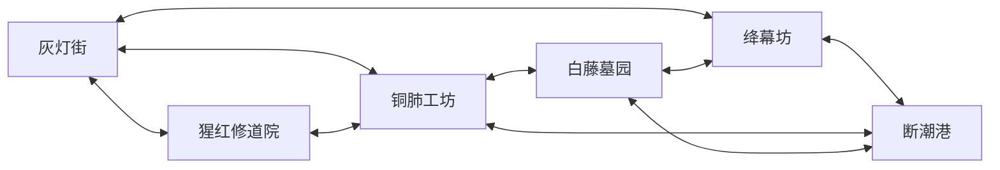

# 全城与续篇规划

状态：续篇提案，待审，未实现。2026-09-14。

莉芙的动机 C、猩红修道院事件线与三条支线已获确认。本文沿用这部分事实；修道院之外的区名、人物职位、事件和全城终局均为候选，不构成新的正式主线。当前地图实现见 [地图实施记录](../MAP_IMPLEMENTATION.md)，修道院故事以 [STORY_REVIEW.md](STORY_REVIEW.md) 为准。旧角色卡与已批准事件线冲突时，采用事件线，不把角色卡里较早的委托或旧关系补回剧情。

## 六区与往返路线

建议以一处常回的街区串联五种工作场所。区名先保持短、能从场景里辨认；只有“猩红修道院”已经用于本轮内容，其余五名待审。

|区域 ID|名称与用途|可辨认的场景|回访时能看到的变化|
|---|---|---|---|
|city_lamp|灰灯街，检修、临时住宿与换乘的据点|矮街灯、架在屋檐之间的输送轨、仍有人坐着的工台|有人接回旧工具后继续开工；有人拒绝再借，工台仍可经过。根据实际任务结果决定哪些原有人物到访，不默认把五名 NPC 全搬来。|
|city_monastery|猩红修道院，已确认的运输交接场所|层叠回廊、装卸礼堂和内外货道|维拉死亡后的货物、工作与通路归属按已批准三支线变化；玛拉处理礼堂，赛琳不自动恢复合作。|
|city_foundry|铜肺工坊，制造和修理城内运输设备|成组排气管、能看到运动方向的传动轴、架空检修道|后续候选事件改变谁掌管停机钥匙、哪些工台开放；机器是否运转直接影响可走的路。|
|city_cemetery|白藤墓园，安葬、家族档案与旧住处的保管地|爬满浅色藤蔓的墓墙、层叠碑廊、仍有生活痕迹的看守房|被归还的物件出现在有人使用的房间，撤下的名牌留有空位。此区不经营遗体买卖，不引入换心或复活。|
|city_curtain|绛幕坊，剧院、裁衣作坊和供长期住客居住的楼层|舞台后侧的红幕、衣架运输道、同一建筑的台口与后巷|公开演出是否继续、谁还能使用后台、哪些门向主角关闭，取决于已发生的行动。|
|city_harbor|断潮港，城外交通与终局候选场地|落差很大的旧码头、干船坞、横跨水面的货运桁架|终局后仍可回城；货物接收人、空置泊位和留下的人表现结果，不用城市被毁强行结束探索。|

箭头表示两向通路的设计要求，尚未生成城外场景。地表街道负责明确的入口与撤回，上层连桥提供战斗换侧，地下运输道接住下落并缩短回程。同一区至少有两个接入方向，第一次进入也有可步行或按常规跳跃返回的路线；全城交通不依赖玩家保留某一枪的弹匣。

## 封锁与开放

下表的设备状态和新通路名都属于待审续篇。实际制作时先放置可见的建筑端点，再接事件；未制作的城区保持完整封闭立面，不铺一条长路通向空气墙。

|连接|初始可见的阻断|候选开放行动|返回条件|
|---|---|---|---|
|灰灯街 ↔ 修道院|办公门拒绝武装人员进入；装卸入口可用|沿现有 mon_01、mon_02 进入，使用已批准交接事件|已开启四条修道院货运通道按既有门状态保存；不另造新的前门钥匙|
|灰灯街 ↔ 铜肺工坊|检修隔离门关闭，门后传动轮仍在转|初入时从外侧楼梯到值守平台，现场停机后开启地面门|外侧楼梯始终可退回；重启生产只改变近路，不把角色关在工坊|
|灰灯街 ↔ 绛幕坊|台口不允许带枪穿行，后巷货门已插栓|从可见消防楼梯进入后台，并从内侧放下货门闩|放下的楼梯和已开的货门保留，演出结束也不重锁|
|修道院 ↔ 铜肺工坊|旧货轨横跨正在交接的卸货线|修道院结尾取得运输去向后，在新关卡内处理占轨货车|先开放并验证旁侧维修步道，再允许货车移动；不要求完成全部支线|
|铜肺工坊 ↔ 白藤墓园|地下运料门被停在坡道上的料斗挡住|抵达工坊后侧，松开机械制动，将料斗固定在下方停靠位|控制柄两端可操作；备用台阶避开轨道，不靠反冲穿过实体料斗|
|白藤墓园 ↔ 绛幕坊|旧阶梯可见，但通向后台的门从里面锁住|先从任一区走到门的一侧，拆下可接近的门闩|永久开门，形成第一条跨区步行环路；不收集一套专用钥匙|
|绛幕坊 ↔ 断潮港|高架桥收起，末段承重销被带回值守房|通过剧院的货运交接取得桥销；也可先走工坊路线到桥另一端|桥放下后双向可走。桥是否开放与演出结局分开，避免故事分支锁死主线|
|铜肺工坊 ↔ 断潮港|干船坞在吊运整块设备，没有安全落脚面|把设备移到已有支架上，开放地面维修道|退出可走外侧高架检修路；不加入隐藏实时时限|
|白藤墓园 ↔ 断潮港|低处排水检修口关闭，外侧能看见另一端灯光|在港内放下检修梯，从内侧开栓|形成终局后的短回程；开放只增添近路，不代替首次可返回的主路|

封锁以建筑使用中的具体事情为理由。岗位、收费权和工钱可以出现在人物争执中，但本文不增加货币、收费门或备用弹药系统。吸血鬼的生理、供血方式和城市人口比例仍未规定，不能借背景道具先把这些空白定死。

## 莉芙为何继续

修道院结束时，莉芙得到城市运输线的消息。消息提供下一处能去的地方，不证明背后有统一操纵者，也不替下一名目标开出必死的罪状。她去见另一个长期留在某个位置上的同族，是想亲自看见对方如何结束那段生活。对方未必要等她问完，更没有义务提供一个完整解释。

后续事件分别安排在生产、保管和表演之中。同一个威胁会碰到不同的行动：有人继续安排下班后的工作，有人先收回借出的钥匙，有人想让自己最后一次被看见的样子符合预先写好的戏。主角的观察范围也跟着改变。她在工坊听见的承诺可以被次日停机推翻，在墓园读到的旧信未必适合解释今天的决定，台上说的话甚至可能写给别的观众。

莉芙仍能离开，章节推进则要求玩家明确选择继续追猎。游戏只在确实实现的地方提供停手或改道；不能给“放过目标”的选项，随后仍让她自动完成相同的猎杀。是否让城外某个目标存活，需要单独审阅整个后续状态，不在本文假定已支持。

追猎会留下可回看的现场。修道院的人是否继续工作、某条运输线是否还有人维护、赛琳是否愿意再提供一次掩护，都来自先前可见的行动。她可以喜欢一个人，也可以给出一次帮助；这些经历不会自动消除她继续追猎的选择。全城主线不预设她最后成为拯救同族的人。

## 三段续篇事件候选

以下使用临时职位描述新人物，尚未给他们定名、建立关系或写入运行 ID。新角色第一次出现时都与主角初识。若成为敌人，遵守成年、露脸的美少女与既有像素动画标准。

### city_foundry_01：最后一班，待审

工坊所有人是一位准备结束经营的长寿吸血鬼。她已答应修完最后一组运输零件，仍要让工人按原时间交班；工人知道要停业，却不知道她已被猎人盯上。莉芙从公开的运货安排找到她，先看见她拒绝撤掉下一班的工位标牌，再当面表明来意。

所有人为了保住交货时间把零件移到另一条线，主角继续追踪，移动的货架改变高处与地面的进场路线。玩家可以先停机保留维修道，或沿外侧高架继续前进；两条路都能撤回。只有玩家主动进入交班事件，尚未完成的工序才按现场标示的安排结束。

更简单的办法是让对方离开，随后问工人发生了什么。莉芙拒绝满足于转述，所以继续接近；对方也可以丢下订单逃走，但这会使她先前给工人的交接承诺失效。两人的选择足以造成冲突，不需要最后补出暗藏的罪行。

候选固定结果是这一次追猎结束了她继续经营的可能；是否采用猎杀结局留待此章评审。可以变化的是停机后的钥匙交给谁、工人能否使用修好的设备、玩家留下的通路是否便于回访。主角在场听到的告别不由旁白解释为真心或谎言。

### city_cemetery_01：收回钥匙，待审

墓园的一位长寿保管人准备关闭自己管理的旧住处。她正在收回曾借出的钥匙，有的房间仍有人定期来坐一会儿。主人已经故去或离开的人物各自是谁，需要后续事件卡逐一确定，不批量用悲惨背景填满房间。

莉芙想知道保管人为何到今天才关门。对方只愿核对哪些钥匙尚未归还。玩家能先帮实际持钥匙的人取回留在室内的东西，也能沿空出的碑廊直接追上保管人；归还物件的地点应在关门前可见。玩家主动开始最后交接后，保管人封存未取走的房间，并改走上层离开。

旧信和交接簿给玩家的只是不同时间的记录。保管人今天的拒绝不等于否认她过去做过的事，也不能让一封藏得更深的信宣布唯一真相。候选的永久变化是部分旧住处停止使用；哪些物件已经交还、哪些人仍持有副钥匙，决定回访中能见到什么。是否让主角杀死此目标另行评审，不用每区新增一位必须死亡的朋友维持黑暗感。

### city_curtain_01：预写的谢幕，待审

剧院的一位长寿表演者知道有人会来找她，提前安排了自己的退场。她愿意在台上回答莉芙的问题，只要主角照她指定的时刻进场。后台工作人员只知道演出安排；谁知道这是一次真实追猎，必须在事件卡中分别记录。

莉芙能接受台口路线，也能从后台提前接近。前者让她看完整段表演，却把进攻位置交给目标；后者打乱台上安排，让玩家接触到正在搬道具的人。改变的是见到的行动和战斗空间，后台路线不会自动更真实。演出者仍可能在那里继续演给另一个人看。

玩家可以在开始演出前撤回灰灯街。主动进入后，候选固定损失是这次完整演出无法按原计划完成；表演者是否死亡与主线走向需独立确认。已经归还的衣物、帮人搬离的道具和透露给工作人员的信息，决定谁还能使用剧院、谁会拒绝莉芙再次进门。

## 港口终局候选

建议把最后一次追猎放在断潮港，而不在终章才揭示一个操纵前面所有人的主谋。最后的目标曾长期负责港口的离城安排，正在将自己的位置交出去。莉芙一路听过她的名字，见过几批由她安排离开的货，却只能在实际抵达港内后第一次见到她。她与维拉之间是否有私人关系仍空缺，不用一段旧情替新事件提供重量。

港口早期先让玩家实际使用两条离城线路，看见同一人怎样决定先放哪一批人或货。接近终局时，目标已经安排好自己的离开，又必须处理她向别人答应过的一次最后交接。玩家主动开始追猎后，她移动货物、停靠设备或换用另一条路，由此前建立的机械规则改变战场。任何永久断路都先留出回城通道。

**终局固定损失候选：莉芙追上并杀死最后的目标，此人不再能继续她尚未完成的关系与承诺。** 固定损失来自主角已说明并实际执行的行动，不安排突发灾难代为杀人。目标死亡后，有些问题再也无法当面问她；找到更多记录仍可能帮助别人办完具体事情，却不会补出一个未经主角干预的完整答案。这一终局尚未获批，不能提前写进结局触发器。

可变后果保留四类具体事情：已经交还的物件由谁拿到；哪些人掌握足以继续维修的记录；离城的人是否履行了与主角说好的接应；城内哪些工作和通路还有人维护。结果改变 NPC 位置、可用协助和回访内容。它们不折算成善恶值，也不决定目标的临终动作究竟代表什么。没有一套集齐支线即可令所有人无损的隐藏答案。

赛琳若出现在终局，前提是她在修道院之后的去向和再次接触过程已写清。她可以只帮完成一件约好的事，随后离开；不能默认为永久队友，也不能用固定死亡替主角完成成长。莉芙最后怎样谈论自己的追猎，允许受她见过的事影响，但不把一句悔悟台词当成已经改变了行为。

## 后续评审与制作顺序

本案优先制作铜肺工坊，因为修道院结尾已经留下运输线接口；灰灯街可先作为已有落脚处的扩展方向审阅。白藤墓园与绛幕坊随后开放任意先后调查，断潮港在两翼至少有一条可用路线后进入。全图探索条件只控制路线和事件时机，单件可漏收线索不得成为主线唯一钥匙。

续篇评审先确定五个新区名、工坊目标的结局、墓园与剧院是否存在存活分支，以及港口终局是否采用上文的主动猎杀。通过后再补新角色卡、每次首次相遇、事件前后的空间状态和独立对白稿。地图原型只在同一套控制器上制作一条可往返主路与一条侧路，测通后再扩区；本文没有批准新武器、移动能力或魔法规则。

另一种可选结构是仅制作工坊和港口，把墓园、剧院保留为可回访支区。它能减少主线目标与结局状态，但城市事件的差异会变少。更松散的多目标顺序结构则需要为每种先后顺序重写各人的已知信息，本轮不建议直接铺开。

## 执行记录

本节记录写作过程，不属于玩家文本。本稿依据已批准 STORY_REVIEW.md；CHARACTERS_REVIEW.md 仅用于确认旧稿边界。保护 player、mara、ina、ruka、vira、celine 及 mon_main_01 至 mon_main_07、三支线 ID，不重建旧关系。本稿未新增可执行事件 ID 或翻译文本。

实际读取：`tools/skills/game-story-workflow/SKILL.md` 与 `references/event-card.md`；`C:/Users/liyian.andy/.agents/skills/game-narrative/SKILL.md`、`references/local-adaptation.md`、`references/agency-agents/narrative-designer.md`、`narratologist.md`、`psychologist.md`、`anthropologist.md` 的相关段落；`C:/Users/liyian.andy/.codex/skills/game-design-natural-writing-zh/SKILL.md`、`humanizer-zh/SKILL.md` 与 `brainstorming/SKILL.md` 的相关段落。未调用叙事子代理。

校对完成：已确认与候选分开；六区都有用途与回访；九条区际连接都说明阻断、开放和返回；新目标不继承旧熟人关系；终局损失有行动原因；未知生理规则保持空白；已删除复活、换心、遗体交易、全知定论和隐藏实时死亡倒计时的依赖。本文是设计审阅稿，不进入运行代码，也不提交版本库。
