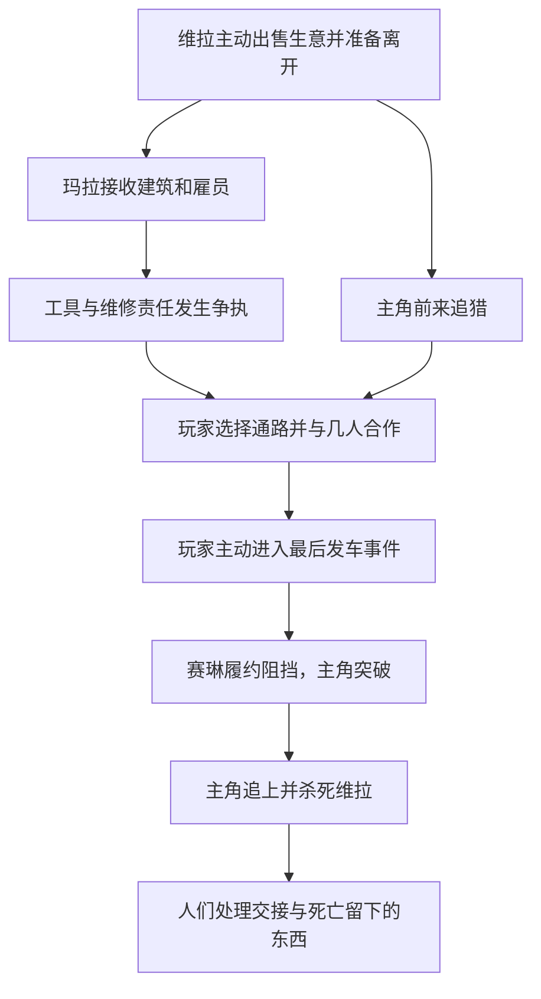

# 猩红修道院故事审阅稿

状态：2026-09-14 用户确认主角动机 C，并批准本稿事件线继续正式接入；具体实现完成度见 IMPLEMENTATION.md。与角色卡共用 player、mara、ina、ruka、vira、celine 六个 ID。此稿不采用换心、遗体拍卖、旧搭档和黑钟主线。

## 主角

莉芙想知道，活得很久的吸血鬼会怎样面对生命结束。她选择亲自追猎，而非只听别人讲述。她会记得目标最后拿了什么、喊了谁的名字、试图从哪扇门逃走，反而不太在意事后的传闻。

她只对死亡临近时能看到的反应感兴趣，却容易忽略那是自己造成的处境。目标撒谎、愤怒或沉默，都可能只是应付眼前的枪。故事不证明她因此看见了别人的本性，也不替她安排一段迫不得已杀人的经历。

她依然会收取报酬、索要通路或合作，但这些只能解释怎么完成追猎。她对目标的好奇才解释为什么有时已经能离开，却还要留下。

## 修道院的处境

维拉在修道院经营运输生意很久，熟悉这座建筑几次扩建前的模样。她决定卖掉这里，带一车私人行李离城。玛拉接下仓库和通路，准备换掉部分旧人。双方已经付过钱，争执集中在交接范围：哪些工具属于建筑、哪些货物仍须送走、谁负责尚未兑现的承诺。

鲁卡想留下闸门工作，又想让别人承认机器一直靠她维护；伊娜想拿回放在仓库里的工具；赛琳受玛拉雇佣，负责让交接如期结束。没人因为莉芙到来才开始有自己的打算。

莉芙听说维拉将离开自己住了很久的地方，主动找来。她想见维拉，也准备杀她。她没有一份证明对方该死的罪状。开场任务让玩家寻找目标与通路，不编造营救借口。

## 主线事件

### mon_main_01：进入外庭

修道院只开放装卸入口，武装人员不能从办公门直接穿行。莉芙从货道进入，遇见因交接争执而交火的旧守卫和新雇员。玛拉愿意告诉她维拉的位置，希望她迫使维拉尽快离开。玛拉尚不知道她一定会追猎到底。

玩家从下路掩体或上层平台进入外庭；两条路都能抵达玛拉，不要求全场清敌。近距离才能交谈，战斗中只有简短提示，不暂停长篇说话。

### mon_main_02：找到维拉

维拉隔着尚未开启的货梯与主角交谈。莉芙直接说明自己是来找她的猎人。维拉没有反复解释自己无辜，只要求她等货装完。她知道有人会追来，却没想到对方会在这里询问她准备带走什么。

维拉从另一端离开，继续装车。玩家能看见她走向哪里；隔断是实际建筑和不同高度，不是人物突然消失。此时尚未取得通向内院的路线，需要从钟台或低处货道绕行。

### mon_main_03：打开两翼通路

伊娜的工具箱可以处理卡住的升降台；鲁卡知道另一条维护道。玩家可先走任一侧，主线只需要一条通向内院的路，第二条是返程和战斗优势。支线不强制完成，工具借还也不改变枪械弹药。

赛琳在上层压制守卫，主角可以借她的火力前进。两人初次合作只是因为对方站在合适的位置。随后一次交火中，赛琳会留下来守住楼梯，让玩家实际体验到把后方交给她是什么感觉。

### mon_main_04：抵达内庭

主角先看到维拉留下的东西，再有机会问她为什么。房间里既有别人珍惜的旧物，也有维拉随手丢掉的信。文本不提前告诉玩家哪件东西代表她真正的感情。

这里允许继续调查三条支线，并明确提示：进入装卸礼堂后，运输会开始，尚未处理的货物将按原清单交接。没有隐藏倒计时；玩家可以离开这扇门返回调查，直到主动确认继续追猎。

### mon_main_05：截住最后一车

维拉发车，赛琳按雇佣约定守住交接线路。她请求主角退开，让车先走。主角可以改变进场路线、交还借用工具、带回记录，但不能用一个“我会放过她”的选项骗过赛琳又自动继续同一剧情。

主角继续追猎后，赛琳成为必须突破的精英对手。打败她会解除封锁，使她失去这次交接工作；本场不强制杀死她。已有合作会改变她的警告、采用的压制位置和战后的交谈，不用隐藏好感值突然决定生死。

### mon_main_06：礼堂追猎

维拉利用装卸层的高差、货厢和动力桥移动。她的目标是带车离开，进攻也围绕重新取得发车位置展开。玩家通过下方换位、上层绕行和破坏其站位逼近，而非守在门口耗血。

此处明确是主线猎杀，不提供实际上无效的赦免选项。维拉在战斗结束后死亡，这是本段固定损失。战斗前已经发生的任务决定会改变她留下的东西，以及几个人最后能拿到什么；不存在藏在支线深处的全员无损答案。

莉芙能看见她在某个瞬间伸手去抓货厢门，却未必知道她想逃、想保护行李，还是只想借门支撑自己。不同证据提供不同解释，不播放全知回忆替玩家定论。

### mon_main_07：回到外庭

玛拉拿到仓库，却必须处理毁坏的礼堂。赛琳留下或离开取决于玩家先前是否把她当作可以商量的人，不再担任末尾旁白。鲁卡和伊娜分别面对自己的工具、岗位和承诺。主角得到通往城市运输线的消息，可以继续追查其他同族，也能回访修道院。

维拉死去不自动改善所有人的生活。有人获得想要的东西，有人失去合作对象；这些变化通过人在什么地方、还能提供什么服务来表现。游戏不显示善恶分数。

## 三条支线

|ID|行动与条件|直接结果|主线后的变化|
|mon_side_tools|在 mon_07 找到被登记为仓库资产的工具箱，交还伊娜，或按玛拉要求留在交接处|交还后开放维护通路；留下则开放仓库取道，两者都有返程|伊娜是否继续在据点工作、玛拉是否愿意共享库房信息；不扣枪械弹药|
|mon_side_records|从 mon_13 找到鲁卡多年手写的维修记录；交给鲁卡、留给玛拉或只阅读|记录证明哪些维修只能由现场人员完成；交付前可自由调查|鲁卡获得继续工作或离开的谈判条件；保留记录不等于自动解决她的处境|
|mon_side_luggage|核对维拉的行李标签，在出发前决定是否按她要求把无标签的箱子退回旧房|货车掩体位置改变；玩家可先看清搬动后哪条射线暴露|决定哪些物品留在修道院，提供不同的临终动作解释；不让道具决定人物有无灵魂|

三支线可任意顺序调查，交付结果只发生一次。最后一车启动后停止未完成的交付，保留已读证据和已有结果；日志写明变化原因，不写“你错过了最佳结局”。

## 因果与认知

主角开场只知道维拉是谁、准备从哪里离开；工具归属、工作关系和私人行李通过现场获得。赛琳只知道自己的工作和亲眼看见的合作，不知道主角在侧房的选择。玛拉看到交付结果后才更新态度。维拉不知道玩家阅读过哪一页记录，除非玩家主动出示。

## 更简单的办法

莉芙当然可以离开，交易也可以在没人死亡时完成。她没有这样做，是因为她选择了追猎；这是人物行为，不用强迫她杀人的新设定掩盖。玩家在进入最终事件前能够回访，剧情不会假称只是去护送货车。

赛琳可以解除雇佣，但她此时想要的是可靠的长期工作。她已先说明任务，并在封锁前要求主角退开。她不会因某句台词忽然变成另一个人，战败后的关系也不会自动回到合作前。

维拉有多条出路，所以地图需要两翼而不是一道神奇门。她被追上是玩家实际穿过通路并赢得战斗的结果。读过所有记录也不能让她未经行动就死亡。

## 关系变化

|关系|触发|变化|
|player—mara|收到入口信息；玩家交还或留下工具|临时合作；之后是否继续互换通路信息|
|player—ina|借出工具；按约归还或转交他人|具体信任或拒绝再借，不称为善恶|
|player—ruka|尊重操作线；交付维修记录|从付费旅客变成能谈事情的人；不新增缴费门系统|
|player—celine|共同交火；最后发车时意见分歧|合作与欣赏保留，但双方不再把对方当作可靠同行者|
|player—vira|公开追猎意图；搬动行李；最终交战|维拉以自己的方式回应，主角始终无法完全知道她的想法|

## 本稿审阅重点

主角动机已选 C，但修道院事件仍需确认：这版把固定死亡放在玩家主动完成的猎杀，而非被动目睹营救失败；保留相处与分歧，不给予主角道德豁免。若用户不接受这一事件走向，保持角色动机 C，重写事件，不回滚至旧器官或葬礼提案。

技能执行：本轮已读取 game-narrative、本地适配、Psychologist、Narrative Designer、Narratologist、game-design-natural-writing-zh、humanizer-zh；新 wrapper 的规则已用于区分确定事实和提案。主角动机由用户回复确认，其他新增内容没有假记为已确认。
